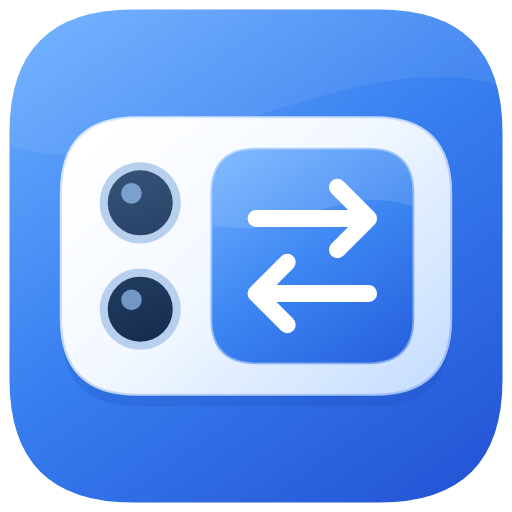

# ReMRSS



为小米17Pro/17Pro Max等双屏设备的背屏一键切换器

本仓库基于 [上游 MRSS 项目](https://github.com/AntiOblivionis/MiRearScreenSwitcher) 继续开发。当前源码更名为 **ReMRSS**，正式包名为 `top.zainzh.rearscreen`，此次更名尚未发布；最近公开的旧版仍为 **MRSS v3.3.2 / 2014（2026-10-16）**。迁移与验证见[身份迁移说明](docs/remrss-identity-validation.md)。

本次更新采用 Compose + Miuix 首页与浮动导航，加入左右滑动、点击切页动画及蓝白背屏新图标，精简关于页，增加基于 Raw 版本清单的检查更新、应用内下载进度、APK 校验和系统安装器接入，并恢复原版腾讯文档教程入口。App 不携带 GitHub Token，更新清单由正式发布成功后的 CI 自动生成。改动与验证见 [首页试点记录](docs/compose-home-validation.md)、[应用内更新验证](docs/in-app-update-validation.md)。

交互及图标的专项验证见[交互验证](docs/navigation-interactions-validation.md)和[图标设计说明](docs/app-icon-design.md)。

## 📦 已发布的旧版：MRSS v3.3.2

- [查看 v3.3.2 Release](https://github.com/lhly/MiRearScreenSwitcher/releases/tag/v3.3.2)
- [下载 APK（约 1.39 MB）](https://github.com/lhly/MiRearScreenSwitcher/releases/download/v3.3.2/MRSS-v3.3.2.apk)
- [下载 SHA256 校验文件](https://github.com/lhly/MiRearScreenSwitcher/releases/download/v3.3.2/SHA256SUMS)
- [v3.3.2 对应源码](https://github.com/lhly/MiRearScreenSwitcher/tree/v3.3.2) · [下载该版本源码](https://github.com/lhly/MiRearScreenSwitcher/archive/refs/tags/v3.3.2.zip)

ReMRSS 提供背屏切换、截图、录屏、通知和充电动画等功能，通过 Shizuku 控制背屏。界面支持深色模式、系统字号、简繁英及横屏；正式 APK 约 1.39 MB，适用于不同 CPU 架构，新包沿用现有签名证书。

v3.3.0 已在小米真机安装验证，背屏磁贴、URI 返回和断线重连记录见 [真机验证记录](docs/hyperos4-tile-validation.md)。v3.3.2 的界面、更新下载/校验及安装器流程已完成模拟器回归，云端发布及下载验收见 [自动发版记录](docs/github-release.md)。

## 📄 开源协议

本项目沿用 **GPL-3.0**，完整条款见 [LICENSE](LICENSE)，原始项目归属、维护贡献和修改日期见 [NOTICE](NOTICE)。可以依照许可证修改与再分发，不提供担保。上游 V3.0.0 以前版本采用 MIT；本项目基于 GPL-3.0 版本继续开发。

APK 内附带完整 LICENSE 和 NOTICE，可在“关于 → 诊断信息 → 开源许可证”离线阅读。源码仓库统一从“关于 → 源码仓库”访问，对应版本的源码可在仓库的 `v<版本号>` tag 中查看。Release 会同时提供完整许可证、贡献说明，以及对应 tag 的源码与构建说明入口。对应版本的线上源码以 Release 所指向的 tag 为准。

**💬 项目与反馈**

- 项目主页：[lhly/MiRearScreenSwitcher](https://github.com/lhly/MiRearScreenSwitcher)
- 问题反馈：[GitHub Issues](https://github.com/lhly/MiRearScreenSwitcher/issues)
- 使用方法：见下方教程；维护分支的问题请提交到本仓库。

---

## ✨ 功能特性 (V3.3.2)

- 🎯 **快捷切换**: 通过控制中心快捷开关一键将应用切换到背屏
- 📸 **背屏截图**: 一键截取背屏画面并保存到相册（自动收起控制中心，keycode唤醒）
- 📹 **背屏录屏**: 悬浮窗控制，录制背屏画面并保存到Movies文件夹（持续keycode唤醒）
- ⚡ **充电动画**: 插电时在背屏显示精美的充电动画（3D闪电+流动液体效果）
- 📢 **通知推送**: 收到通知时自动在背屏显示通知内容（支持应用选择+隐私模式+动态重载）
- 🔓 **后台可用**: 即使应用在后台也能正常触发切换
- 🚀 **无需ROOT**: 基于Shizuku实现，无需ROOT权限
- 🎨 **界面与主题**: 柔光玻璃卡片、悬浮导航，支持深色模式、系统字体缩放和简体/繁体中文/英文
- 🛡️ **智能保护**: 防止系统Launcher覆盖投射的应用
- 💡 **背屏常亮**: 可选的背屏常亮功能，防止自动息屏
- 🔄 **智能监控**: 背屏应用退出或切换时自动清除通知
- 📱 **DPI调整**: 支持动态调整背屏DPI，优化显示效果（推荐260-350）
- 🤚 **背屏遮盖检测**: 可选的接近传感器检测功能
- 🔄 **背屏旋转**: 支持背屏0°/90°/180°/270°旋转，应用自动复活
- 🚫 **任务隐藏**: 主应用不在最近任务列表显示，防止误清理
- 🌐 **URI调用**: 支持通过mrss://协议从外部应用控制ReMRSS（Tasker/MacroDroid等）
- 🔔 **智能通知**: 支持跟随系统勿扰模式和仅倒扣手机时通知（基于主屏接近传感器检测）
- 🎬 **媒体库集成**: 截图和录制自动刷新到相册，方便查看

## 📋 使用前提

1. **设备要求**: 支持背屏的小米手机（小米17Pro/17Pro Max等双屏设备）
2. **Shizuku**: 需要安装并启动Shizuku
   - 下载地址: [Shizuku官网](https://shizuku.rikka.app/)
   - 启动方式: ADB或无线调试

## 🚀 使用方法

### 1. 初次设置

1. 当前 ReMRSS 尚未发布，可按下方说明构建；上方 Release 下载为旧 MRSS
2. 确保Shizuku已启动
3. 打开ReMRSS应用，授予Shizuku权限
4. 等待状态显示"一切就绪"

ReMRSS 正式包名为 `top.zainzh.rearscreen`，调试包名为 `top.zainzh.rearscreen.debug`，与旧 MRSS 分别保存数据，可同时安装。更换包名后无法覆盖旧版，首次使用需重新配置、授权 Shizuku/通知等权限并添加磁贴；暂不自动读取旧包私有配置。`mrss://`（调试版 `mrss-debug://`）保持不变，若检测到其他应用也能处理该协议，首页顶部和自动化弹窗会提示冲突并列出相关应用。自动化工具可指定目标包名，避免打开旧版。

### 2. 添加快捷开关

1. 从屏幕顶部下拉打开**控制中心**
2. 点击**编辑按钮**
3. 找到以下快捷开关并添加：
   - **切换至背屏**: 将当前应用投放到背屏
   - **获取背屏截图**: 截取背屏画面并保存
   - **背屏录制**: 录制背屏画面（可选）
4. 完成！

### 3. 日常使用

**切换应用到背屏：**
1. 打开任意想要切换到背屏的应用
2. 下拉控制中心
3. 点击"**切换至背屏**"快捷开关
4. 服务就绪后应用切换到背屏，控制中心自动收起；连接尚未就绪时磁贴会显示“正在连接服务...”，等待最多 5 秒
5. 翻转手机即可在背屏查看

显示“正在连接服务...”时请保持控制中心展开，收起面板会取消尚未开始的切屏请求。若提示“请先启动 Shizuku”或“请先打开应用授权”，先按提示完成启动或授权再点击。

**截取背屏画面：**
1. 下拉控制中心
2. 点击"**获取背屏截图**"快捷开关
3. 控制中心自动收起，截图保存到相册

**录制背屏画面：**
1. 下拉控制中心
2. 点击"**背屏录制**"快捷开关
3. 悬浮窗出现，点击红色圆形按钮开始录制
4. 录制中按钮变为方形，再次点击停止录制
5. 视频保存到Movies/ReMRSS_*.mp4

**返回主屏：**
- 方法1: 点击通知"点击将应用切换回主屏"
- 方法2: 在背屏退出应用，通知自动消失

**充电动画和通知：**
- 充电动画: 插电时自动显示闪电图标充电动画，可在应用内关闭
- 通知推送: 在应用内启用，选择需要推送的应用，支持隐私模式、勿扰模式跟随和仅倒扣手机时通知，自动销毁时间可自定义（无上限）

**调整背屏显示：**
- DPI调整: 在应用内设置，推荐260-350
- 旋转控制: 支持0°/90°/180°/270°旋转
- 背屏常亮: 可在应用内开关
- 背屏遮盖检测: 可在应用内开关（基于接近传感器）

**💡 提示**: 
- 即使ReMRSS应用在后台或已关闭，快捷开关依然可以正常使用！
- ReMRSS不会出现在最近任务列表，避免误清理
- 背屏常亮功能可在应用内开关
- 应用退出或切换时，通知会自动清除
- 充电动画和通知推送都可独立开关
- 支持通过URI调用（mrss://switch?current=1等）

## 🔧 技术实现

- **Compose + Miuix**: 首页卡片、开关和底部导航；Android 13 起支持内容背景模糊，旧系统使用实体材质。
- **Android View**: Java 保留通知、关于、应用列表、系统对话框和既有背屏服务。
- **Shizuku**: 提供shell权限执行特权操作
- **TaskServiceManager**: 统一共享 UserService 连接，检查 Binder 存活并在断开后重连；磁贴通过连接回调执行，切屏后校验任务实际显示屏
- **Quick Settings Tile**: Android系统级快捷开关服务（切换/截图/录屏）
- **ActivityTaskManager**: 通过system service调用实现显示切换
- **Foreground Service + WakeLock**: 前台服务持有唤醒锁，可选的背屏常亮
- **NotificationListenerService**: 系统通知监听，实时推送到背屏
- **Keycode Wakeup**: 使用input keyevent KEYCODE_WAKEUP精确唤醒背屏
- **Media Scanner**: 自动刷新媒体库，截图和录制自动出现在相册
- **Dynamic Animation Reload**: 通知动画动态重载机制，支持连续通知
- **Rear Animation Manager**: 统一管理充电动画和通知动画，实现动画打断
- **智能监控**: 每2秒检测背屏前台应用，自动清除无效通知
- **充电监听**: BroadcastReceiver监听充电事件，触发背屏动画
- **3D动画**: 自定义Canvas绘制，非线性动画，重力感应液体效果
- **接近传感器检测**: 主屏接近传感器实时检测，支持倒扣手机时通知功能
- **Screenshot & Record**: screencap截图 + screenrecord录屏
- **URI Protocol**: 支持mrss://协议外部调用

## 📝 权限说明

- `moe.shizuku.manager.permission.API_V23`: Shizuku API权限，用于执行特权操作
- `android.permission.WAKE_LOCK`: 保持背屏常亮
- `android.permission.FOREGROUND_SERVICE`: 前台服务权限
- `android.permission.POST_NOTIFICATIONS`: 通知权限（Android 13+）
- `android.permission.BIND_NOTIFICATION_LISTENER_SERVICE`: 通知监听服务（可选）
- `android.permission.SYSTEM_ALERT_WINDOW`: 悬浮窗权限（录屏功能需要）
- `android.permission.QUERY_ALL_PACKAGES`: 获取应用列表（通知功能需要）
- 系统广播接收: 监听`ACTION_POWER_CONNECTED/DISCONNECTED`充电事件

## 🛠️ 开发构建

构建需要 JDK **21**、Gradle **9.7.1**、AGP **9.4.1**、Kotlin **2.4.20**、Android SDK **37.0** / Build Tools **37.0.0**，不再需要 Flutter、Dart 或 NDK。版本在 `version.properties` 中维护，当前版本为已发布的 `3.3.2 / 2014`。项目本机工具和缓存位于被 Git 忽略的 `.local/`，换机器时需准备 Java/SDK 并调整路径。

Release 需要 `android/key.properties` 和正式签名密钥；参考 `android/key.properties.example`，ReMRSS 正式包名固定，不再追加 `.personal`。缺少正式签名时构建会失败。Android Studio 请打开 `android/`，操作及密钥备份见 [正式 APK 构建说明](docs/android-studio-release.md)。

```bash
source .local/env.sh

# 调试版（.debug 包名、mrss-debug://）
./android/gradlew -p android :app:assembleDebug

# 正式 APK（R8 混淆与资源压缩，无 CPU 架构限制）
./tools/build_release.sh
```

输出：`build/app/outputs/apk/debug/app-debug.apk`、`build/app/outputs/apk/release/app-release.apk`。同包名覆盖升级时自动导入旧设置；不同包名之间不会自动迁移数据。迁移对应表和体积测量见 [v3.3.0 验证记录](docs/native-ui-validation.md)。

### GitHub tag 自动发版

本仓库的四项签名 Secrets 已配置完成。v3.3.2的公开APK、签名和自动更新清单已验收，对应源码由同名tag提供。工作流只在推送 `v*` tag 时触发，构建正式 APK、检查签名/版本/包名、生成 `SHA256SUMS`，附带 `LICENSE`、`NOTICE` 和对应源码说明，再发布 GitHub Release，并在正式发布成功后更新 Raw 版本清单；普通分支推送不触发发版。

当前 `version.properties` 为 `versionName=3.3.2`、`versionCode=2014`，对应版本已经发布。以下是本次执行记录；后续发版应先递增版本号和构建号，使用新的 tag，不要重复创建 `v3.3.2`：

```bash
git push origin main
git tag -a v3.3.2 -m "MRSS 3.3.2"
git push origin v3.3.2
```

tag 的版本必须与 `version.properties` 的 versionName 一致，versionCode 需递增；已发布的 tag 不再重复创建或覆盖。其他仓库需配置自己的签名 Secrets 和预期证书。完整配置及预览版规则见 [自动发版说明](docs/github-release.md)。

## 🔍 技术细节

### V3.0 核心功能

1. **智能应用切换** 🎯
   - 通过Quick Settings Tile快捷开关触发
   - 使用`am stack`命令获取前台应用
   - 调用`service call activity_task 50`切换显示屏
   - 自动杀死系统Launcher防止挤占
   - Toast提示显示具体应用名

2. **充电动画** ⚡
   - 插电时自动在背屏显示充电动画
   - 3D玻璃闪电容器 + 流动绿色液体
   - 重力感应真实液体效果
   - 非线性动画，从0%填充到当前电量
   - UI图标使用闪电⚡标识，更符合充电主题
   - 可在应用内开关，支持充电动画常亮模式

3. **通知推送** 📢
   - NotificationListenerService监听系统通知
   - 选择需要推送的应用（支持搜索、批量选择）
   - 通知内容显示在背屏（应用图标+标题+内容）
   - 隐私模式：隐藏通知具体内容
   - 精美动画：图标缩放+内容淡入
   - 自动销毁时间可自定义（无上限，支持任意时长）
   - 通知开关状态持久化，重启后正确恢复

4. **背屏录屏** 📹
   - 悬浮窗控制，红色圆形/方形按钮
   - 使用screenrecord录制背屏画面
   - 持续唤醒背屏防止录制中断
   - 视频保存到Movies/ReMRSS_*.mp4
   - 可拖动悬浮窗位置

5. **前台Service保活** 🛡️
   - 统一的"MRSS内核服务"前台通知
   - 可选的背屏常亮功能（FLAG_KEEP_SCREEN_ON）
   - 点击通知可快速返回主屏
   - 主应用隐藏于最近任务，防止误清理

6. **智能监控与清理** 🔄
   - 每2秒检测背屏前台应用状态
   - 应用退出或切换时自动停止服务并清除通知
   - 防止多应用同时投放

7. **DPI动态调整** 📱
   - 支持实时调整背屏显示密度
   - 使用`wm density`命令修改
   - 一键还原默认设置
   - 推荐范围: 260-350

8. **背屏旋转控制** 🔄
   - 支持4个方向: 0°/90°/180°/270°
   - 使用`wm user-rotation -d 1`独立控制背屏
   - 旋转后应用自动复活
   - 实时显示当前旋转状态

9. **背屏遮盖检测** 🤚
   - 可选的接近传感器检测功能
   - 应用内可开关
   
10. **URI协议支持** 🌐
   - mrss://switch?current=1 - 切换当前应用
   - mrss://switch?packageName=xxx - 切换指定应用
   - mrss://return?current=1 - 返回主屏
   - mrss://screenshot - 截图
   - mrss://config?dpi=xxx&rotation=x - 配置，rotation传入的旋转应为0-3，与adb shell相同

### V3.0 新增特性

- ✅ **充电动画**: 3D闪电容器 + 重力感应液体
- ✅ **通知推送**: 系统通知实时显示到背屏
- ✅ **背屏录屏**: 悬浮窗控制录制功能
- ✅ **URI调用**: 支持外部应用控制（Tasker等）
- ✅ **精美UI**: 四色渐变 + 超椭圆圆角设计
- ✅ **代码优化**: 移除未使用代码，修复乱码问题

### V3.2.0 新增特性

- ✅ **仅倒扣手机时通知**: 通过主屏接近传感器检测，仅在手机倒扣时显示背屏通知
- ✅ **传感器检测优化**: 实时监听主屏接近传感器，准确判断手机状态

### V3.1.3 新增特性

- ✅ **多语言支持**: 完整支持简体中文、繁体中文和英文，自动跟随系统语言
- ✅ **UI细节优化**: 修复多语言环境下的UI显示问题，优化文本换行和对齐
- ✅ **通知本地化**: 通知标题和内容支持多语言显示

### V3.1.2 新增特性

- ✅ **应用选择优化**: 选中的应用在列表中自动置顶显示，方便管理
- ✅ **击杀逻辑优化**: 优化launcher击杀策略，改为仅在动画启动前击杀一次，避免频繁操作

### V3.1.1 新增特性

- ✅ **服务保活优化**: ChargingService 添加前台服务保活，防止被系统杀死
- ✅ **通知统一管理**: 所有服务使用统一的内核服务通知，避免多个通知堆积
- ✅ **设置状态修复**: 修复 NotificationService 设置冲突问题，确保状态一致性

### V3.1.0 新增特性

- ✅ **充电动画图标优化**: 充电动画UI图标从灯泡改为闪电图标，更符合充电主题
- ✅ **通知开关状态修复**: 修复背屏通知开关状态持久化问题，重启后状态正确恢复
- ✅ **通知服务状态同步**: 修复通知服务开关状态同步问题，关闭后再开启可正常工作
- ✅ **自动销毁时间无上限**: 解除通知自动销毁时间60秒上限限制，支持自定义任意时长

### 性能优化

- ✅ 代码混淆（ProGuard/R8）
- ✅ 资源压缩
- ✅ Kotlin / Java，移除 Flutter 渲染引擎，保留多架构支持
- ✅ APK体积优化

## 📄 许可证

**V3.0.0及以后版本**: GPL-3.0 License - 详见 [LICENSE](LICENSE) 文件
**V3.0.0以前版本**: MIT License

---

## 📝 更新日志

### 未发布

- 应用更名为 ReMRSS，源码命名空间与正式包名统一为 `top.zainzh.rearscreen`，支持与旧版并存。保留原自动化协议，增加首页及自动化弹窗的冲突警告；新版 CI 使用独立更新清单，详情见[身份迁移说明](docs/remrss-identity-validation.md)。

- 关于页“检查更新”下方加入默认关闭的镜像代理开关，记住选择；开启后通过第三方 gh-proxy.com 读取版本清单和下载 APK，继续验证哈希、包名、版本与签名。详见[镜像代理验证](docs/update-proxy-validation.md)。

- 精简更新弹窗，目标版本只展示一次；下载、进度、校验、失败重试和安装授权均在同一弹窗内继续，不再跳转独立下载页面。关闭弹窗会取消下载，屏幕旋转保留任务；详见[弹窗下载验证](docs/update-dialog-validation.md)。

### V3.3.2（2026-10-16，本分支，已发布）

- 正式应用名称简化为 MRSS，当前维护者仅在关于页“源码仓库”栏展示，移除其他界面及后续发版标题的重复个人标识。
- 重新设计蓝白背屏图标，统一桌面/关于页，支持自适应形状、单色主题和状态栏轮廓；移除旧密度PNG，正式APK约1.39MB，见[图标说明](docs/app-icon-design.md)。
- 三个主页面支持跟手左右滑动、点击切页动画与联动导航指示；保留各页滚动位置和设置，支持快速反向操作及系统关闭动画，详见[交互验证](docs/navigation-interactions-validation.md)。

- 首页与底部导航采用 Compose + Miuix 0.9.4，保留设置/服务行为，支持实时背景模糊及旧系统降级，详见 [验证记录](docs/compose-home-validation.md)。

- 关于页精简为当前版本与维护者、源码仓库、检查更新、提交反馈、原始作者、自动化入口和诊断信息；离线许可证与重启功能收进诊断弹窗。背屏页“控制中心快捷磁贴”恢复打开原版腾讯文档教程。
- 关于页“检查更新”按需读取 GitHub Raw 的 `version.json`，区分可更新、版本相同、本地构建较新、清单不可用与网络失败，发现新版后可在应用内下载并查看进度，校验大小、SHA256、包名、版本及签名后唤起系统安装器，由用户确认安装；支持取消、失败重试与发布页入口。清单及下载/校验信息由 CI 在正式发布成功后更新，App 不携带 Token。
- 移除原作者的打赏与 QQ 群入口，保留 AntiOblivionis 和汐木泽的原始项目/测试贡献致谢。
- APK 打包完整 GPL-3.0 和 NOTICE，支持离线阅读；Release 附对应版本 tag 的源码和构建文档链接。
- 保留原始源码署名，追加维护贡献与修改日期；正式包名和签名保持不变。

### V3.3.0 (2026-10-13，本分支，已发布)

- 设置界面迁移到 Android 原生，移除 Flutter 引擎、Dart AOT 和旧界面资源，正式 APK 由 17.69 MB 缩至约 0.58 MB。
- 重新设计背屏、通知、关于三页及应用选择，采用轻量柔光玻璃视觉，支持深色/系统字号/简繁英/横屏。
- 保留 DPI/方向、遮盖检测、常亮、充电动画、通知隐私/条件/时长、应用搜索/批量选择、教程/支持/URI/诊断等功能，以及既有 Shizuku 与背屏控制逻辑。
- 同包名升级自动导入旧设置，继续兼容旧磁贴和服务偏好键；沿用个人正式签名。
- 本机 30 项测试、Lint、正式构建与验签通过；tag 自动发版和公开下载复核通过，APK 为 581,195 字节。已在小米真机安装验证，使用未发现问题。

### V3.2.1 (2026-10-13，本分支)

#### 磁贴切屏修复

- 统一共享 Shizuku TaskService 的连接与释放，避免磁贴、Keeper、通知和充电等组件相互销毁服务。
- 磁贴改为异步等待连接回调后执行，加入 5 秒等待超时、重复点击去重和 Binder 存活检查。
- 切屏操作在后台线程执行，并核对任务实际所在显示屏，避免仅凭命令退出码误报成功。
- 修复测试版使用独立 `.debug` 包名和 `mrss-debug://`，URI 路由按构建配置选择协议。

#### 正式构建与自动发版

- 配置个人正式签名与 `.personal` 包名，缺少正式签名时停止构建。
- 固定 Flutter 3.35.7 / JDK 21 等构建工具，提供 Android Studio“构建正式 APK”入口和终端构建脚本。
- 推送版本 tag 后自动运行检查、构建并验签，发布 ARM64 APK、`SHA256SUMS` 和版本说明，支持预览版及草稿失败重跑。

#### 验证结果

- 修复测试版完成真实控制中心重复切屏、URI 拉回和远端断开后重连验证。
- 云端 9 项发布参数测试和 16 项服务生命周期回归通过，v3.2.1 构建和发布任务成功。
- 从公开 Release 下载的正式 APK 签名、包名、版本、ARM64 AOT 结构及 SHA256 校验通过。

### V3.2.0 (2025)

#### 新功能
- **仅倒扣手机时通知**: 通知功能新增"仅倒扣手机时通知"选项，通过检测主屏接近传感器判断手机是否倒扣，仅在倒扣时显示背屏通知

#### 功能优化
- 将"仅在锁屏时通知"功能改为"仅倒扣手机时通知"，使用接近传感器检测更准确
- 优化通知检测逻辑，实时监听主屏接近传感器状态

#### 技术优化
- NotificationService 新增主屏接近传感器监听器
- 优化传感器检测算法，距离小于最大距离20%视为遮盖

### V3.1.3 (2025)

#### 新功能
- 完整的多语言支持（简/繁/英）
- 通知内容和Toast消息全面本地化

#### 优化
- 修复英文模式下UI文本溢出问题
- 优化多语言环境下的文本显示效果

### V3.1.2 (2025)

#### 功能优化
- 应用选择列表中，选中的应用自动置顶显示，未选中的应用在下方
- 优化充电动画和通知动画的launcher击杀逻辑，改为仅在动画启动前击杀一次

#### 技术优化
- 移除充电动画常亮循环中的持续击杀launcher逻辑
- 移除通知动画循环中的持续击杀launcher逻辑
- 应用选择列表排序逻辑优化，切换选择时自动重新排序

### V3.1.1 (2025)

#### 问题修复
- 修复 ChargingService 缺少前台服务保活导致的功能失效问题
- 修复 NotificationService 设置冲突导致的状态不一致问题
- 统一所有服务使用内核服务通知，避免通知栏堆积

#### 技术优化
- ChargingService 现在使用统一的内核服务通知保活
- NotificationService 设置加载逻辑优化，避免状态冲突
- 服务稳定性提升，减少被系统杀死的概率

### V3.1.0 (2025)

#### 新功能
- 充电动画UI图标从灯泡改为闪电图标
- 解除通知自动销毁时间60秒上限限制

#### 问题修复
- 修复背屏通知开关状态持久化问题，重启后状态正确恢复
- 修复通知服务开关状态同步问题，关闭后再开启可正常工作
- 修复通知服务每次收到通知时重新加载开关状态

### V3.0.0 (2025)

#### 重大更新
- 采用GPL-3.0开源协议
- 全新充电动画：3D闪电容器 + 重力感应液体效果
- 通知推送功能：系统通知实时显示到背屏
- 背屏录屏功能：悬浮窗控制录制
- URI协议支持：支持外部应用控制（Tasker等）
- 精美UI：四色渐变 + 超椭圆圆角设计

## 👥 维护者与原始贡献

### 当前源码

[当前源码仓库](https://github.com/lhly/MiRearScreenSwitcher)

- 自 2026-10-11 起维护本分支，修改包括共享 Shizuku 服务连接修复、正式构建与自动发版、Android 原生界面迁移。
- 2026-10-13 调整维护者身份、项目与反馈入口、原始项目致谢和开源声明，详见上方更新日志与 [NOTICE](NOTICE)。
- 本分支独立维护；当前版本的反馈和发布由本仓库负责。

### 原始项目与致谢

- **原始作者：AntiOblivionis** — [上游项目](https://github.com/AntiOblivionis/MiRearScreenSwitcher) · [酷安主页](https://www.coolapk.com/u/8158212)。感谢其创作并开源 MRSS；上游已公告无限期停更。
- **上游测试贡献者：汐木泽** — [酷安主页](https://www.coolapk.com/u/4279097)。感谢其提供的关键测试反馈和功能建议。

保留上游 Git 历史和源文件中的原始作者声明。本分支新增贡献与原始项目贡献的归属说明见 [NOTICE](NOTICE)。

### 上游历史 AI 协作记录

上游 README 记录其历史版本使用 Cursor、Claude-4.5-Sonnet、GPT-5 和 Gemini-2.5-Pro 协作开发；此记录归属于上游版本。维护分支的具体改动以 Git 提交和更新日志为准。

## 🙏 致谢

- [Shizuku](https://github.com/RikkaApps/Shizuku) - 提供特权API支持
- Flutter团队 - 历史版本使用的跨平台框架
- Xiaomi HyperOS 小米澎湃OS团队 - 小米手机背屏功能

---

## 📜 版权声明

### 图标归属

本应用使用的图标及品牌标识归属如下：

1. **应用图标**：本应用图标直接使用了小米HyperOS系统中的图标资源。根据[小米操作系统用户协议](https://terms.miui.com/doc/eula/cn.html)，小米、MIUI、Xiaomi HyperOS等商标及相关图标的版权归小米科技有限责任公司所有。本应用仅为第三方开发的辅助工具，与小米官方无关，如有侵权请联系删除。

2. **酷安图标**：应用内使用的酷安图标归酷安（北京酷安网络科技有限公司）所有。根据[酷安用户协议](https://m.coolapk.com/mp/user/agreement)，酷安的商标、图标等知识产权归其所有。本应用使用酷安图标仅用于跳转链接标识，不代表与酷安有任何官方合作关系。

### 免责声明

本应用为 GPL-3.0 开源项目，基于Shizuku实现背屏功能扩展，可依照许可证使用、修改与再分发。使用本应用即表示您理解并同意：
- 本应用非小米官方应用，与小米公司无任何关联
- 使用本应用的风险由用户自行承担
- 开发者不对使用本应用造成的任何损失负责
- 如有侵权，请联系删除

---


